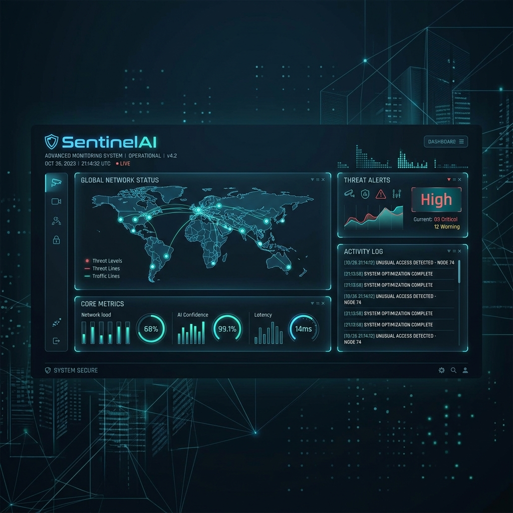
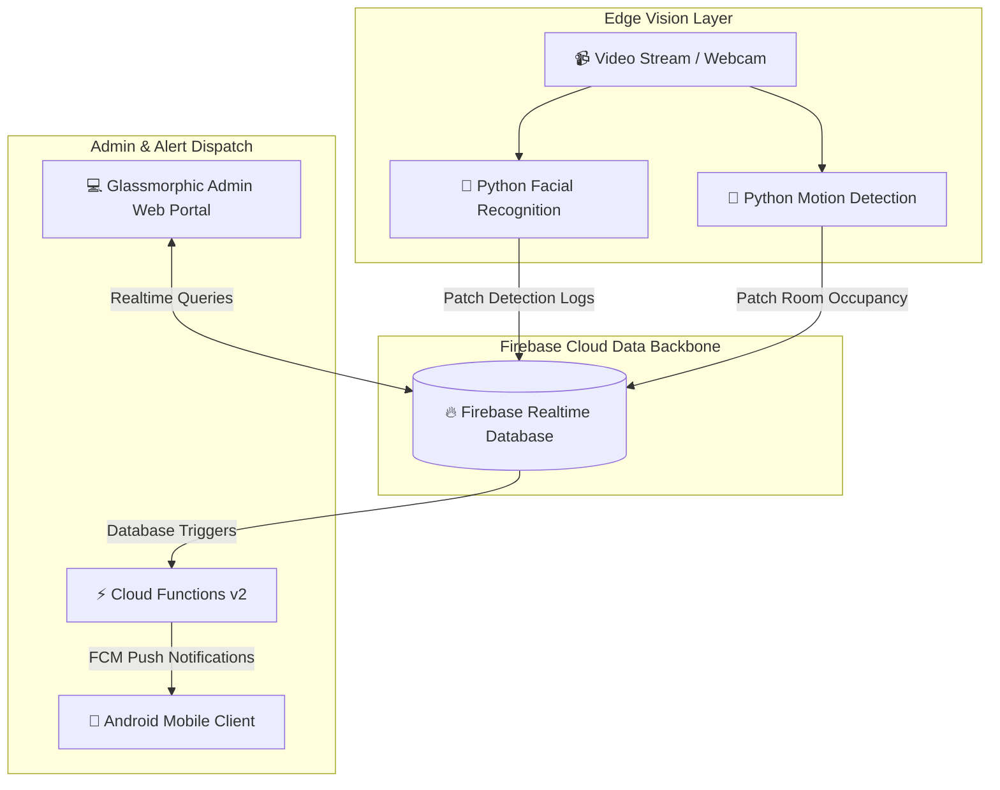

<div align="center">



# SentinelAI — Smart AI Surveillance & Monitoring Platform

[](https://opensource.org/licenses/MIT)
[](https://www.python.org/)
[](https://nodejs.org/)
[](https://firebase.google.com/)
[](https://developer.android.com/)
[](https://docs.astral.sh/uv/)

**SentinelAI** is an end-to-end, multi-technology AI surveillance and facility monitoring platform originally developed as a college capstone project at **Vellore Institute of Technology (VIT)**. It integrates real-time computer vision, background motion analysis, a glassmorphic admin command center, serverless database triggers, and mobile emergency notifications into a unified security architecture.

[System Architecture](#-system-architecture) •
[Key Modules](#-key-modules) •
[Quick Start](#-quick-start) •
[Documentation](#-academic--project-documentation) •
[License](#-license)

</div>

---

## 🛠️ System Architecture



---

## ✨ Key Modules & Capabilities

### 1. 🔍 Facial Recognition System (`facial-recognition/`)
* **Dual Detection Engines**: Supports fast HOG (Histogram of Oriented Gradients) for edge devices like Raspberry Pi and deep learning CNN for high-accuracy desktop processing.
* **Embedding Quantification**: Pre-computes 128-d facial embeddings using dlib and OpenCV, serializing encodings for zero-latency runtime comparison.
* **Dual Firebase Sync**: Uses `firebase-admin` SDK with an automatic fallback to the Firebase Realtime Database REST API.
* **Managed via `uv`**: Fully configured with `pyproject.toml` and PEP 723 inline dependency metadata for zero-setup execution.

### 2. 🏠 Room Occupancy & Motion Detector (`facial-recognition/motion_detector.py`)
* **Background Subtraction**: Analyzes frame deltas using Gaussian blurring and thresholding to detect movement.
* **Occupancy Logging**: Tracks room status transitions (`Occupied` / `Unoccupied`) and increments interval counters in Firebase.

### 3. 💻 Admin Command Center (`WebApp/`)
* **Glassmorphism Design System**: Built with modern CSS custom properties, backdrop blur, Inter typography, and subtle micro-animations.
* **Live Stats & Activity Feed**: Queries Firebase Realtime DB asynchronously for live room counts, employee registrations, and login activity logs.
* **Data Export Engine**: Export tracking tables and room logs directly to CSV format.
* **Interactive Modules**: Includes Prisoner Monitoring search, Room Occupancy heatmap views, and Employee Access Operations.

### 4. ⚡ Serverless Cloud Functions (`firecast/functions/`)
* **Node.js 18 & Functions v2**: Built on Firebase Functions `onValueUpdated` triggers.
* **Emergency Dispatch**: Monitors emergency database flags and fires FCM push alerts to registered security devices.

### 5. 📱 Android Emergency Alert Client (`CapstonePrototype/`)
* **Modernized to API 34**: Built with Kotlin, AGP 8.3.2, and current Firebase AndroidX SDKs.
* **Push Notifications**: Receives FCM payload alerts when emergency security thresholds are breached.

---

## 🚀 Quick Start

### 1. Web Application Command Center

```bash
# Serve static files locally with any HTTP server
npx serve WebApp

# Or navigate directly:
# Open WebApp/login.html in your browser
```

1. Open [firebase-config.js](./WebApp/firebase-config.js) and replace placeholders with your Firebase credentials.
2. Open [login.html](./WebApp/login.html) to access the portal.

---

### 2. Python Computer Vision Engine

Ensure [`uv`](https://docs.astral.sh/uv/) is installed.

```bash
cd facial-recognition

# 1. Install dependencies into managed venv
uv sync

# 2. Encode face dataset
uv run encode_faces.py --dataset dataset --encodings encodings.pickle --detection-method hog

# 3. Launch real-time face recognition
uv run pi_face_recognition.py --cascade haarcascade_frontalface_default.xml --encodings encodings.pickle

# 4. Launch motion-based room occupancy detector
uv run motion_detector.py --room R0101
```

> **Zero Setup Mode (PEP 723)**: You can also run any script standalone without running `uv sync` first — `uv run motion_detector.py` will auto-install dependencies into an isolated cache.

---

### 3. Firebase Cloud Functions

```bash
cd firecast/functions

# Install dependencies
npm install

# Deploy functions to Firebase
firebase deploy --only functions
```

---

## 📚 Academic & Project Documentation

All original capstone thesis documents, research paper, review presentations, and architectural flowcharts have been migrated from Google Drive into the repo:

```
docs/
├── thesis/
│   ├── BIS-28-Thesis.pdf.enc             # Encrypted 90+ page Capstone Thesis
│   ├── BIS-28-Research-Paper.pdf.enc     # Encrypted Published Research Paper
│   ├── BIS-28-Poster.pdf.enc             # Encrypted Academic Conference Poster
│   └── Project-Completion-Report.pdf.enc # Encrypted Formal Project Sign-off Report
├── reviews/
│   ├── 01_First-Review_Template.ppt.enc  # Encrypted First Review Presentation
│   ├── 02_Second-Review_Template.ppt.enc # Encrypted Second Review Presentation
│   └── Final-Review.pptx.enc             # Encrypted Final Viva Presentation
├── architecture/
│   ├── face-recog-workflow.png           # Computer Vision Pipeline Diagram
│   ├── project-flowchart.drawio          # System Flowchart (Draw.io)
│   └── facenet-architecture.drawio       # Embedding Architecture (Draw.io)
├── references/                           # 8 Encrypted Referenced Research Papers (.pdf.enc)
├── screenshots/                          # Project UI & System Screenshots
└── crypt_docs.py                         # Encryption/Decryption utility script
```

---

## 📄 License

This project is licensed under the **MIT License** — see the [LICENSE](./LICENSE) file for details.

---

<div align="center">

*Developed at Vellore Institute of Technology (VIT)*

</div>
